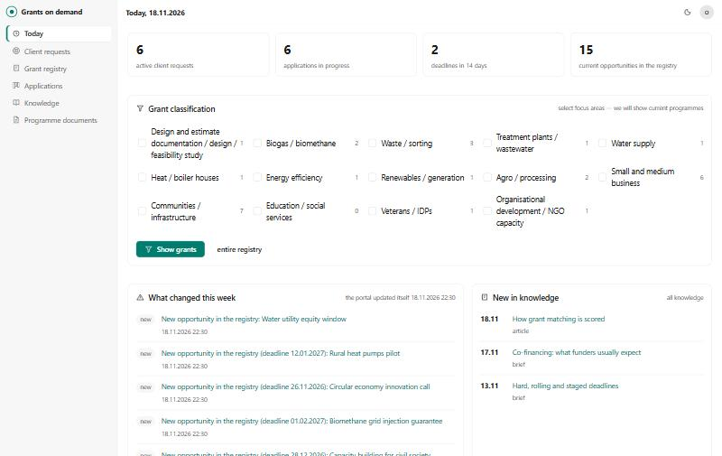

# Grants on demand — grant-matching portal

[](../../actions/workflows/ci.yml)

An internal portal of a project office that raises grant funding for clients (municipalities,
utilities, farms, small businesses): **client requests → explainable grant matching →
applications moving through gated stages → versioned documents with sign-off.** A person always
submits the application; the portal never does.

This repository is a **public showcase**: the code of a system used in production, with every
piece of real data removed. The demo runs on synthetic data from `app/seed_demo.py` (fictional
funders and programmes on `*.example` domains, fictional clients and people).



## Run it

```bash
docker compose up --build        # http://localhost:8070
```

Accounts and a 3-minute walkthrough: [DEMO.md](DEMO.md). `docker compose down -v` resets the data.

Without Docker (Python 3.12):

```bash
python -m venv .venv && . .venv/bin/activate
pip install -r requirements-dev.txt
HRANTY_ENV=demo python -m app.seed_demo
HRANTY_ENV=demo uvicorn app.main:app --port 8070
```

## What is inside

| Area | What it does |
|---|---|
| Grant registry | Programmes with funder, type, amount range, deadline and reliability; idempotent import (`POST /api/ingest/radar`, Bearer token) with an ingest gate — invalid rows are counted and reported, never silently dropped. |
| Client requests | What the client needs money for; tags are derived from the text and can be corrected by hand. |
| Matching | Six weighted components, **each with a reason**: sector tags 0.35 · applicant type 0.20 (hard filter) · amount 0.15 · deadline 0.15 · geography 0.10 · reliability 0.05. Missing data scores a neutral 0.5 and is shown as "no data", never as zero. |
| Applications | Idea → Screening → Documents → Submission → Result. Each transition has a **gate** (score or a stated reason · verdict "apply" · required documents signed off · submission recorded by a person). |
| Documents | Versions grouped per application, sign-off by a person with the right **who is not the author** (identity is the account id), in-browser preview for PDF/text (office formats optionally via LibreOffice). |
| Today | Deadlines, new strong matches, team tasks and a "what changed" feed. |
| Daily self-maintenance | A background job (once a day, in-process) closes programmes whose deadline passed, flags those closing within 14 days, opens follow-up tasks for applications in progress on a closed programme, recomputes matches and announces new strong ones. Each run is journaled (`IngestLog`, feed `obslugovuvannya`); repeated runs are idempotent. |
| Knowledge | Short articles and briefs with sources; Markdown is HTML-escaped and link targets are limited to http(s), mailto and same-site paths. |

## Security

Implemented in [`app/authkit.py`](app/authkit.py) (shared with the sibling [Project Office CRM](https://github.com/zvirmykhailo1987-cyber/project-office-crm)) and covered by tests:

- **Individual accounts** (the former shared team password and the "open mode" are gone).
- **Passwords**: argon2id; legacy `sha256(secret+password)` hashes are upgraded on first login.
- **Sessions**: server-side, absolute expiry + idle timeout, revocable (logout, "sign out everywhere"), rotated on login.
- **CSRF**: double-submit token + Origin/Referer check on every unsafe browser request;
  the Bearer-token API does not use cookies.
- **Login rate limiting**: 5 failures lock the (client IP, login) pair for 15 minutes; separate,
  higher thresholds per IP (30) and per login (50) stop spraying and distributed guessing without
  letting one client lock everybody out.
- **Request size limits**: an ASGI guard answers 413 before any form or upload is parsed
  (sign-in and CSP-report bodies are capped at 16 KB).
- **Cookies**: `Secure` + `__Host-` prefix in every environment except local development.
- **Headers**: strict CSP with nonces (no inline scripts, handlers or styles), CSP reporting,
  `frame-ancestors 'none'`, `nosniff`, COOP/CORP, HSTS in production; documents are previewed
  in a sandboxed frame with their own CSP.
- **Deny-by-default authorisation on the route**: roles with capabilities (approve, send, delete,
  data); a generated test walks every route (anonymous → login, missing CSRF → 403, missing capability → 403).
- File uploads: extension allow-list, size limit, random stored names, path-traversal guard, SHA-256 dedup.
- Open-redirect guard on every `next`/return parameter.

## Quality gates

Run in CI ([`.github/workflows/ci.yml`](.github/workflows/ci.yml)): ruff · mypy (strict on the
security/i18n core) · pytest with an every-screen crawl and generated access-boundary tests ·
line + branch coverage gate (`--cov-fail-under=99`) · pip-audit · bandit · PII pattern scan of
the repo and a freshly seeded demo database · Docker build + health check. Numbers: `python scripts/metrics.py`.

- **Tests:** 340 · **coverage of `app/`:** 99.9 % of lines, 99.6 % lines + branches
  (`branch = true`; `app/seed_demo.py` is omitted, it is exercised by the screen crawl). No
  `# pragma: no cover` anywhere in `app/`.
- **Mutation check:** 30 of 30 injected bugs caught ([`docs/mutation-results.json`](docs/mutation-results.json)).
  Each mutation removes one guarantee (a stage gate, author ≠ approver, "no data" ≠ zero, the ingest
  gate's count of invalid rows, the daily job's idempotency and journal, a route's capability check,
  session idle expiry, CSRF, login lockout) from a temporary copy, and the whole suite must fail.
  Run: `python scripts/mutation_check.py` (`--check` only verifies that every mutation still applies).

## Internationalisation

English by default, Ukrainian as the second language. Catalogue: [`app/locale/en.json`](app/locale/en.json);
a test crawls every screen in English and fails on any untranslated string.

## Known limits

- SQLite, single process (in-memory login limiter); sized for a team.
- Identifiers are transliterated Ukrainian (`potreby` = requests, `zayavky` = applications, `reyestr` = registry).
- The production system's programme-document harvester (a CLI crawler) is not part of this
  showcase, and the planned agent worker (stage B) is not implemented — the API exposes only the
  ingest endpoint.
- The login limiter lives in memory: lockouts and the list of clients that signed in before
  are lost on restart. A distributed guessing burst (50 failures for one login) locks that
  login for 15 minutes for every client that has not signed in to it before, including the
  owner on a new device.
- In-browser preview of Word/Excel/PowerPoint files needs LibreOffice in the image
  (`docker compose build --build-arg OFFICE_PREVIEW=1`); the default image previews PDF, text,
  images and sandboxed HTML, and offers the original for download otherwise.
- Amount parsing is heuristic (UA/EN/IT formats, ranges, multipliers); an unparsed amount stays
  as text and is left out of budget matching rather than guessed.

## License

[MIT](LICENSE) © 2026 Mykhailo Zvir. Keep the copyright notice in copies and derived work.
